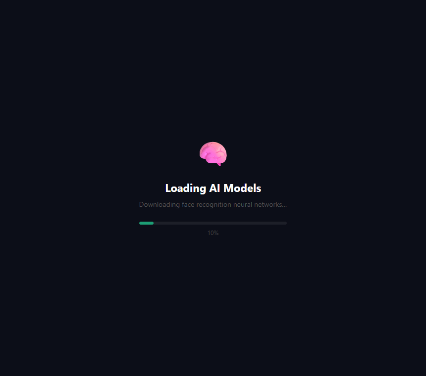
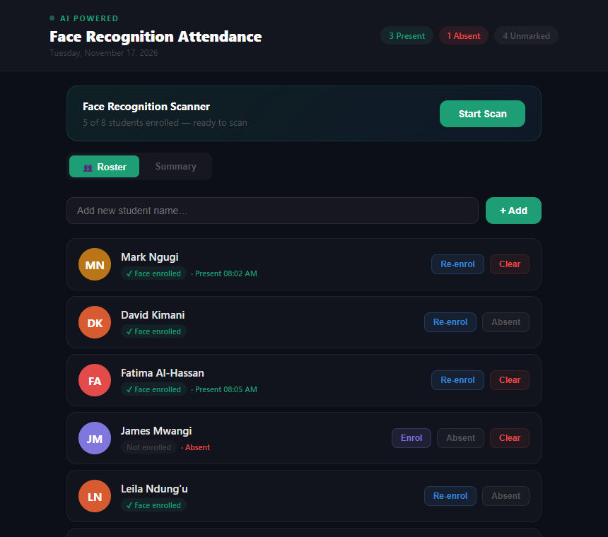
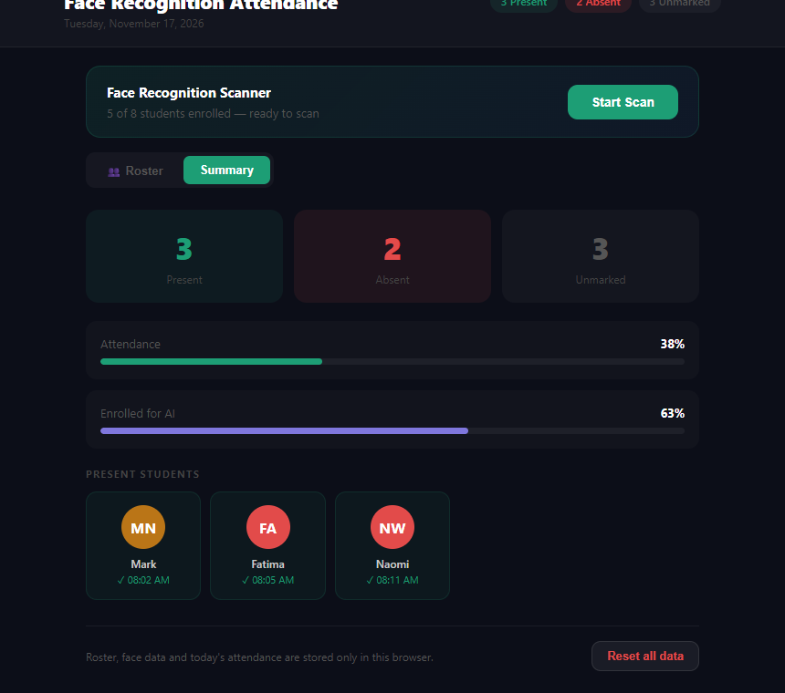
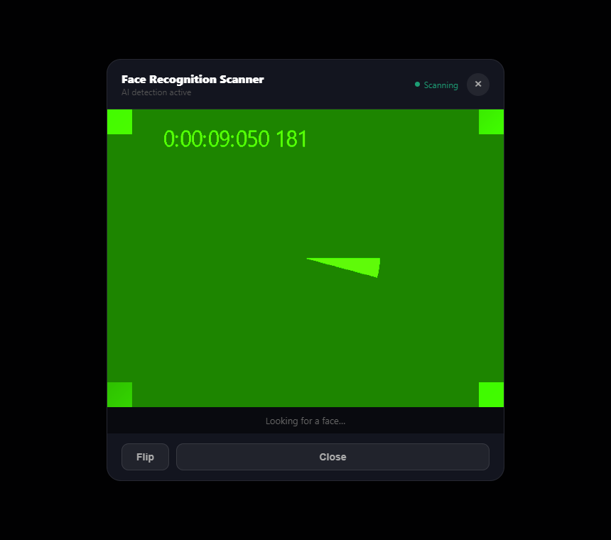
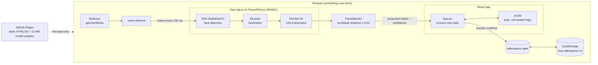

# Simple Facial Recognition Attendance

[](https://github.com/markgee-ui/Simple--facial--recognition--attendance/actions/workflows/ci.yml)
[](https://github.com/markgee-ui/Simple--facial--recognition--attendance/actions/workflows/deploy.yml)

**Take class attendance by pointing a webcam at students. Face detection and recognition run entirely in the browser: no server, no account, and no images leave the device.**

### ▶ [Live demo](https://markgee-ui.github.io/Simple--facial--recognition--attendance/)

Open it in Chrome, Edge or Firefox on a laptop or phone, allow camera access, enrol your own face against a roster entry, then hit **Start Scan**.



<sub>The walkthrough uses seeded demo data and a synthetic browser test camera. Recognition itself needs a real face in front of a real webcam.</sub>

---

## The problem

Paper roll-calls and sign-in sheets in a 40-student class cost 5–10 minutes per session, and they are easy to game ("sign me in"). Commercial biometric systems fix that, but they need dedicated hardware, a cloud subscription and sending students' faces to a third party, which is a hard sell for schools and small training centres.

This app is the minimum viable alternative:

- **Any device with a camera** becomes the attendance terminal.
- **Faces never leave the browser.** Neural-network inference runs on-device via WebGL.
- **A human stays in the loop.** A recognised face is *proposed*, and the teacher confirms with one tap.
- **Zero infrastructure.** It's a static site, so hosting is free.

## Features

| | |
|---|---|
| **Enrolment** | Capture a student's face from the webcam. A 128-d face descriptor plus a cropped avatar are stored. |
| **Live scanning** | Detection every 700 ms with bounding box and 68-point landmark overlay. Matches are shown with a confidence score. |
| **Confirm-to-mark** | "Mark present" records the check-in time. Re-scanning someone keeps their *first* check-in. |
| **Manual overrides** | Mark absent or clear a mark per student. Add students with duplicate/empty-name validation. |
| **Daily summary** | Present / absent / unmarked counts, attendance and enrolment rates, and a grid of present students with times. |
| **Persistence** | Roster and enrolments survive reloads. Attendance resets each calendar day. One-click **Reset all data**. |

| Roster | Summary | Scanner |
|---|---|---|
|  |  |  |

## Architecture



**Request flow for a scan**

1. `getUserMedia` streams the camera into a `<video>` element.
2. Every 700 ms (skipping a tick if the previous inference hasn't finished) a frame goes through *detect → landmarks → descriptor*.
3. `FaceMatcher` compares the descriptor against every enrolled student and picks the nearest one under the distance threshold, or "unknown".
4. The UI projects the box and landmarks onto the video (accounting for `object-fit: cover` cropping) and offers **Mark present**.
5. State changes are written to `localStorage`, scoped to today's date.

### Project structure

```
src/
├── App.jsx                 # UI: loading → permission → main / enrol / scan screens
├── App.test.jsx            # integration tests (face-api + camera mocked)
├── lib/
│   ├── attendance.js       # counts, percentages, idempotent marking, roster validation
│   ├── recognition.js      # thresholds, cover-fit projection, crop clamping, matcher
│   └── storage.js          # versioned, day-scoped, defensive localStorage persistence
└── test/setup.js
public/models/              # self-hosted face-api weights (detector, landmarks, recogniser)
.github/workflows/
├── ci.yml                  # lint + tests with coverage + build, Node 22 and 24
└── deploy.yml              # test + build + deploy to GitHub Pages on push to main
```

## Getting started

**Prerequisites:** Node.js 22+ and a machine with a webcam.

```bash
git clone https://github.com/markgee-ui/Simple--facial--recognition--attendance.git
cd Simple--facial--recognition--attendance
npm ci
npm run dev          # http://localhost:5173
```

`localhost` counts as a secure context, so camera access works without HTTPS during development. To test from a phone on your LAN you need HTTPS (e.g. `npx vite --host` behind a tunnel, or deploy).

| Script | What it does |
|---|---|
| `npm run dev` | Vite dev server with HMR |
| `npm test` | Run the Vitest suite once |
| `npm run test:watch` | Vitest in watch mode |
| `npm run coverage` | Tests + v8 coverage report in `coverage/` |
| `npm run lint` | ESLint (React Hooks + Refresh rules) |
| `npm run build` | Production build to `dist/` |
| `npm run preview` | Serve the production build locally |

## Testing & CI

- **51 tests** across unit and integration suites, run with [Vitest](https://vitest.dev) and [Testing Library](https://testing-library.com).
- `src/lib` (all the decision-making logic) has **~98% line coverage**. These are pure functions, so they're tested without a camera, WebGL or model weights.
- `App.test.jsx` mocks `@vladmandic/face-api` and `navigator.mediaDevices` to test the user flows: model load success and failure, permission denied, add/duplicate student, mark/clear, persistence across reload, reset, and empty-roster percentages.
- The camera and inference paths in `App.jsx` (≈50% coverage) depend on real hardware and are verified manually and by a headless-browser smoke run against the deployed site.
- **CI** ([`ci.yml`](.github/workflows/ci.yml)) runs lint → tests with coverage → build on Node 22 and 24 for every PR and every push to `main`. The coverage report is uploaded as an artifact.
- **CD** ([`deploy.yml`](.github/workflows/deploy.yml)) re-runs the tests, builds, and publishes to GitHub Pages on every merge to `main`.

## Architecture & Decisions

### 1. On-device inference instead of a recognition API

| Option | Pros | Cons |
|---|---|---|
| **Browser (face-api.js / TF.js)** ✅ | Faces never leave the device. No server to run, secure or pay for. Works offline after first load. | ~12 MB of weights on first visit. Speed depends on the client GPU. No central records. |
| Server (Python + dlib/InsightFace) | Stronger models, central database, multi-device reporting | Biometric data in transit and at rest on a server means consent, retention and breach liability. Hosting cost. |
| Cloud API (AWS Rekognition, Azure Face) | Best accuracy, zero ML work | Per-call cost, vendor lock-in, and you're sending minors' faces to a third party. |

For a classroom tool, **privacy and zero running cost beat the last few points of accuracy**. That decision drives every other one below.

### 2. No backend database (yet): `localStorage` instead of Postgres or MongoDB

There is no server, so there is no database. State is a small JSON document (roster, 128-float descriptors, today's marks) that fits easily within `localStorage`'s ~5 MB quota. The storage layer is still built like a real persistence boundary:

- **Versioned key** (`face-attendance:v1`) so a schema change can migrate or reset safely instead of crashing on old data.
- **Validation on read:** descriptors must be exactly 128 numbers, students need an id and a name, and corrupt JSON returns `null` and falls back to defaults.
- **Day scoping:** attendance from yesterday is dropped while roster and enrolments carry over.
- **Failure-tolerant writes:** quota-exceeded or blocked storage (private mode, sandboxed iframes) is reported, never thrown. The app keeps working in memory.

**If this grew a backend** (multi-classroom, term reports, multiple devices), I'd choose **PostgreSQL + [pgvector](https://github.com/pgvector/pgvector)** over MongoDB:

- The core data is relational: `students ⟷ enrolments ⟷ sessions ⟷ attendance`. Reports like "attendance rate per student per term" are joins and aggregates, which SQL does natively and transactionally.
- `pgvector` stores the 128-d descriptors next to that relational data and does nearest-neighbour search (`ORDER BY embedding <-> $1 LIMIT 1`) in the same query. With Mongo, I'd likely need Atlas Vector Search or a separate vector store.
- Uniqueness ("one attendance row per student per session") is a constraint in Postgres and application code in Mongo.

### 3. SSD MobileNetV1 detector instead of Tiny Face Detector

face-api ships both. `TinyFaceDetector` is ~190 KB and much faster, but noticeably worse at off-angle and small faces. Attendance is taken at arm's length and at roughly one frame per 700 ms, so **accuracy matters more than frame rate**, and the larger SSD model (≈5.4 MB) is still real-time enough on a mid-range laptop.

### 4. Match threshold 0.52 (stricter than face-api's 0.6 default) plus human confirmation

The two error types don't cost the same:

- **False negative** (not recognised): the teacher waits a second or marks the student manually. Cheap.
- **False positive** (the wrong student marked present): a silent, wrong record. Expensive.

So the threshold is tightened from 0.6 to 0.52, and nothing is written until a human taps **Mark present**. Detection confidence is also stricter for enrolment (0.45) than for scanning (0.42), because the reference image needs to be clean. All thresholds are named constants in [`recognition.js`](src/lib/recognition.js).

### 5. One reference image per student

This keeps enrolment to a single click. The trade-off is sensitivity to lighting or glasses changes between enrolment and scanning. **Re-enrol** overwrites the reference. The natural next step is to store 3–5 descriptors per student (`LabeledFaceDescriptors` already accepts an array).

### 6. Self-hosted model weights and a relative base path

Weights are served from `public/models` rather than a CDN, so the app has no third-party runtime dependency and works on an offline intranet. `base: './'` in Vite plus `import.meta.env.BASE_URL` for the model path mean the same build runs at `/`, at `/<repo>/` on GitHub Pages, or in any sub-folder.

### Edge cases handled

| Case | Handling |
|---|---|
| Student re-scanned after being marked present | Idempotent: the original check-in time is kept |
| Inference slower than the 700 ms interval | Tick skipped. Detections never stack on the GPU |
| Video displayed with `object-fit: cover` | Overlay uses cover-fit scale and offset, so boxes stay aligned |
| Face at the edge of the frame during enrolment | Crop rectangle clamped to the frame (no black borders) |
| Empty or duplicate student names | Rejected (case- and whitespace-insensitive) with an inline error |
| Empty roster | Percentages return 0, never `NaN` |
| Model weights fail to download | Explicit error screen instead of an endless spinner |
| Camera permission denied / camera in use | Specific message plus retry |
| Device with one camera taps **Flip** | Message instead of a silent failure |
| Corrupt / old-format / blocked `localStorage` | Falls back to defaults. App still works in memory |
| New day | Attendance resets automatically; roster and faces persist |

### Known limitations

- **No liveness detection.** A printed photo of an enrolled student can be recognised. Blink or head-turn challenges would be the next security step.
- **Single-device data.** Records live in one browser. Export (CSV) or a backend (see §2) is needed for reporting.
- **Bundle size.** TF.js makes the JS bundle ~1.5 MB (≈400 KB gzipped). Lazy-loading face-api after first paint would shorten time-to-interactive.
- **Demographic bias.** Pretrained face-recognition models perform unevenly across skin tones, ages and genders. The human-confirmation step is partly a mitigation for this, not a cure.
- **Biometric data and consent.** Descriptors are biometric data under GDPR / Kenya's Data Protection Act. Real deployments need informed consent and a retention policy. The in-app **Reset all data** is a start, not a compliance programme.

## Development workflow

- `main` is always deployable and protected by CI. Every merge auto-deploys.
- Work happens on short-lived branches (`feat/…`, `fix/…`, `ci/…`, `docs/…`) merged through pull requests. See the [closed PRs](https://github.com/markgee-ui/Simple--facial--recognition--attendance/pulls?q=is%3Apr+is%3Aclosed).
- Commits follow [Conventional Commits](https://www.conventionalcommits.org) (`feat:`, `fix:`, `test:`, `ci:`, `docs:`, `refactor:`).

## Tech stack

React 19 · Vite 8 · [@vladmandic/face-api](https://github.com/vladmandic/face-api) (TensorFlow.js) · Vitest 5 · Testing Library · ESLint 10 · GitHub Actions · GitHub Pages
